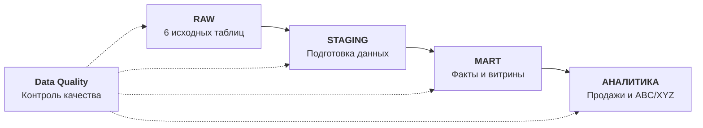
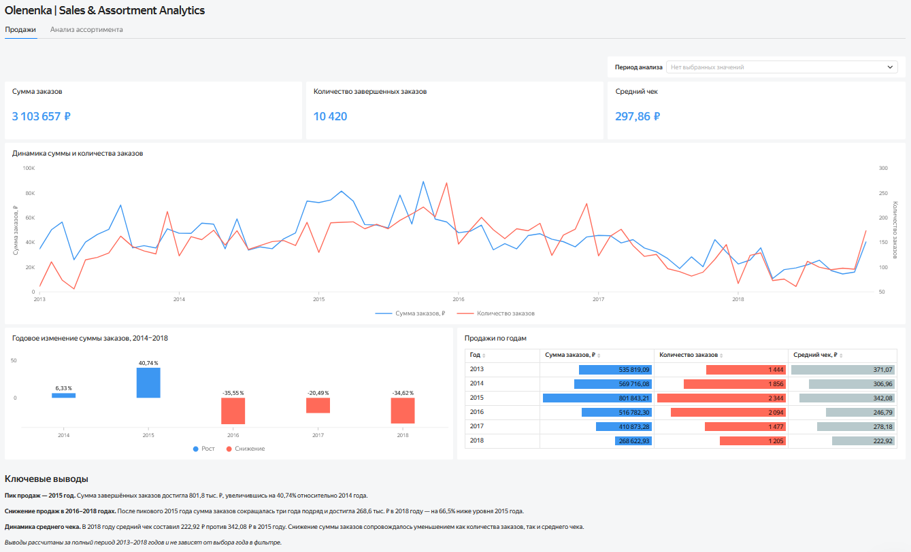
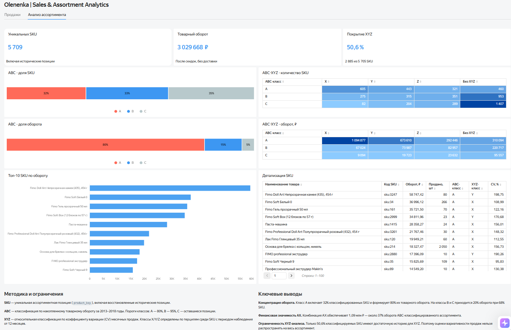
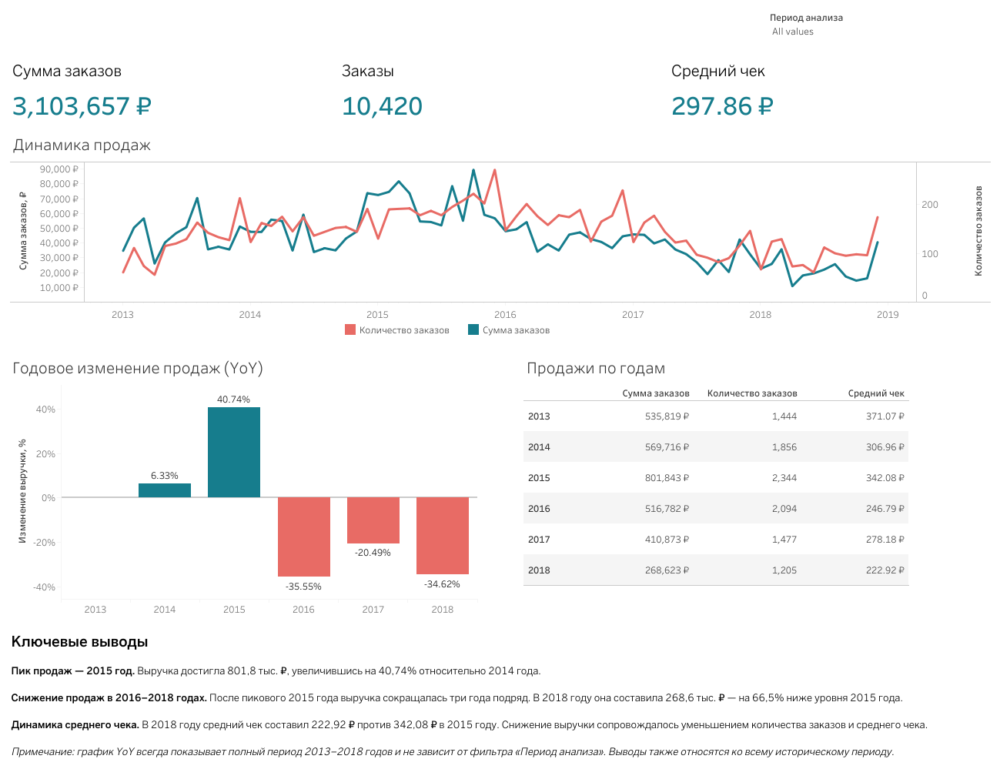
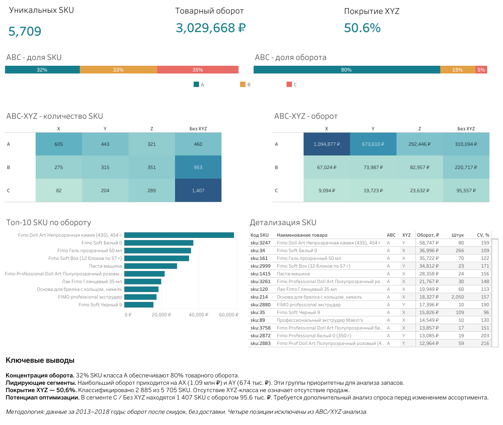

# Olenenka DWH

Аналитическое хранилище исторических продаж интернет-магазина на PostgreSQL 18. Проект объединяет данные Webasyst для анализа товарного оборота, восстановления удалённых SKU и сегментации ассортимента.

В MART хранятся факты заказов и позиций и расширенный каталог. Месячная витрина заказов включает доставку, товарные витрины показывают оборот после пропорционального распределения скидки. Исходная скидка позиции хранится отдельно. Исторические отклонения выделяются финансовой сверкой и сохраняются по номеру заказа.

Идентификация опирается на SKU, а для ранних позиций с нулевыми ID восстанавливает артикул из названия. Неоднозначные артикулы разделяются по нормализованному названию. Универсальные карточки и неопознанные группы сохраняются в обороте и исключаются из ABC.

Основной период — 2013–2018 годы по дате создания завершённых заказов. ABC использует пороги накопленного оборота 80% и 95%, сохраняя единый класс для равных оборотов. XYZ сравнивает коэффициенты вариации месячного количества по терцилям, учитывая внутренние нули. Группы с интервалом короче 12 месяцев остаются без класса.

## Результаты и проверка

Полная пересборка хранилища выполнена дважды подряд в PostgreSQL 18 на базе `olenenka_dwh_test` с использованием исторических RAW-данных. Оба запуска завершились успешно (`COMMIT`, код возврата `0`). Все проверки Data Quality пройдены, контрольные показатели финансовой сверки, ABC и XYZ совпали.

| Контроль | Результат |
|---|---:|
| Заказы и позиции в фактах | 12 894 / 86 896 |
| Завершённые заказы и позиции за 2013–2018 | 10 420 / 61 057 |
| Месяцы / строки SKU × месяц | 72 / 37 653 |
| Сумма завершённых заказов | 3 103 656,890 ₽ |
| Товары после скидок / доставка | 3 029 667,683 ₽ / 73 975,100 ₽ |
| Остаточное отклонение / исключения | 14,107 ₽ / 13 |
| Исторические группы / группы в продажах | 878 / 5 709 |
| ABC A / B / C / исключено | 1 829 / 1 894 / 1 982 / 4 |
| XYZ X / Y / Z / короткая история | 962 / 962 / 961 / 2 820 |

Около 32% классифицированных групп формируют около 80% их оборота. Для 2 820 товарных групп период наблюдения составляет менее 12 месяцев, поэтому XYZ-класс не присваивается. Классы X/Y/Z определяются по терцилям коэффициента вариации среди групп с достаточной историей и отражают относительную вариативность продаж, а не абсолютную стабильность спроса. Webasyst отражает только часть офлайн-операций после изменения учёта, а отсутствие продаж может быть связано с отсутствием товара. Классы рассчитаны на всём периоде.

## BI-дашборд в DataLens

**[Открыть интерактивный дашборд в Yandex DataLens](https://datalens.yandex/s5oqkmvrmwdeb?_share_link=public)**

Дашборд построен на проверенных аналитических витринах Olenenka DWH и включает две вкладки:

- **Продажи:** динамика суммы и количества завершённых заказов, средний чек, годовые изменения (YoY).
- **Анализ ассортимента:** ABC/XYZ-сегментация, матрицы количества SKU и товарного оборота, топ-10 SKU и детализация позиций.

<table>
  <tr>
    <th align="center">Продажи</th>
    <th align="center">Анализ ассортимента</th>
  </tr>
  <tr>
    <td width="50%">
      
    </td>
    <td width="50%">
      
    </td>
  </tr>
</table>

## BI-дашборд в Tableau

[Открыть интерактивный дашборд Tableau](https://public.tableau.com/views/OlenenkaSalesAssortmentAnalytics/sheet1)

Дашборд построен на проверенных витринах Olenenka DWH и включает две вкладки: «Продажи» и «Анализ ассортимента». Реализованы KPI, динамика продаж, YoY, ABC/XYZ-анализ и детализация SKU.

<table>
  <tr>
    <th align="center">Продажи</th>
    <th align="center">Анализ ассортимента</th>
  </tr>
  <tr>
    <td width="50%">
      
    </td>
    <td width="50%">
      
    </td>
  </tr>
</table>

Источники BI — подготовленные CSV-снимки аналитических витрин. Исходные клиентские данные не публикуются.

## Запуск

Основной сценарий — sql/00_rebuild.sql. Он запускает 28 модулей в одной транзакции и проверяет имя базы. Для полного прогона нужен приватный исторический RAW владельца проекта. Открытый комплект содержит SQL и документацию. Локальная приёмка выполнена владельцем проекта на исходном снимке.

- [Инструкция запуска и повторной проверки](docs/RUNBOOK.md)
- [Методика и трактовка показателей](docs/METHODOLOGY.md)
- [Отчёт о приёмке, исправлениях и готовности](docs/AUDIT.md)
- [Структура и состав репозитория](FILE-MAPPING.md)
- [SHA256 всех SQL-файлов](SHA256SUMS)
